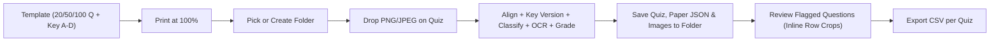

# AutoGradeQuiz

AutoGradeQuiz grades multiple-choice answer sheets from scanned or photographed A4 pages. Each scan session or term lives in its own `workspace/<Folder Name>/` directory on disk managed by the FastAPI backend—holding `folder.json`, `classes.json`, `students.json`, and per-quiz folders (`quiz.json`, `papers/`, and raw/aligned scan images). Disk is the sole source of truth: no browser IndexedDB store is used and no default folder is auto-created.

> **Status:** Verified on synthetic sheets (`78` backend tests in `backend/tests/`, `39` frontend unit tests in `frontend/tests/`). Not yet calibrated on real photographed paper under uneven lighting.

- [Tech Stack & Dependencies](#tech-stack--dependencies)
- [How the Bubble Scanning Pipeline Works](#how-the-bubble-scanning-pipeline-works)
- [Part 1: Backend](#part-1-backend)
- [Part 2: Frontend](#part-2-frontend)
- [Project Layout](#project-layout)



---

## Tech Stack & Dependencies

### Backend (`backend/pyproject.toml`, Python 3.13+)

| Library | Version | Role |
| --- | --- | --- |
| `fastapi` + `uvicorn[standard]` | `>=0.115.0` / `>=0.32.0` | HTTP API (`/health`, `/scan-key`, `/workspace/folders/*`, `/workspace/templates/*`) |
| `opencv-python-headless` | `>=4.10.0` | Otsu thresholding, contour fiducial detection, 4-point perspective warp, and connected-component bubble analysis |
| `numpy` | `>=2.1.0` | Vectorized circular disc masks, per-sheet white/black ink calibration, and percentile measurements |
| `pytesseract` | `>=0.3.13` | Tesseract OCR wrapper (`--psm 7`) for reading `Name`, `Date`, `Class`, and `Student ID` header boxes |
| `pillow` | `>=11.0.0` | Printable 300 DPI PDF template generation (`Key Version: A B C D` bubble strip included) |
| `pydantic` + `pydantic-settings` | `>=2.9.0` / `>=2.6.0` | Request/response validation and environment configuration (`TESSERACT_CMD`, `AUTOGRADE_DATA_DIR`, `AUTOGRADE_WORKSPACE_DIR`) |
| `pytest` + `ruff` *(dev)* | `>=8.0` / `>=0.8.0` | Unit/integration test runner and linter |

### Frontend (`frontend/package.json`, Node.js 22.6+)

| Library | Version | Role |
| --- | --- | --- |
| `next` + `react` + `react-dom` | `16.3.0` / `19.2.8` | App Router UI (`/`, `/classes`, `/classes/[id]`, `/students`, `/students/[id]`, `/quizzes/[id]`, `/review`) |
| `tailwindcss` | `^4` | Styling and design tokens |

---

## How the Bubble Scanning Pipeline Works

Every `POST /grade` or folder quiz grade request runs a 4-stage pipeline in `backend/app/`:

1. **Fiducial Detection & Perspective Alignment (`scan_alignment/aligner.py`)**
   - Each A4 sheet (`210 × 297 mm` at `300 DPI` = `2480 × 3507 px`) has four `8 × 8 mm` solid black corner fiducials plus asymmetric mid-edge markers.
   - The aligner tests all 4 cardinal orientations (`0°`, `90°`, `180°`, `270°`), locates the corner squares inside corner search windows via Otsu thresholding and min-area rectangle filtering (falling back to a mid-edge marker if one corner is clipped), warps the sheet back to canonical A4 coordinates with `cv2.getPerspectiveTransform`, and picks the orientation where the expected mid-marker positions are darkest.
2. **Per-Sheet Ink Calibration (`bubble_grading/classifier.py`)**
   - Each aligned sheet calibrates its own `white` level (median pixel intensity of the blank lower paper band) and `black` level (median intensity of the inner 50% of the four corner fiducials).
   - Every pixel is converted into a normalized ink fraction in `[0.0, 1.0]`: `clip((white - px) / (white - black), 0, 1)`.
3. **Key Version Strip, Inner-Disc Classification & Partial-Credit Scoring (`bubble_grading/`)**
   - Reads the printed `Key Version: A B C D` strip below the header (`classify_key_version`), selects the matching key version when configured, and flags ambiguous/multiple/unconfigured marks for teacher review.
   - Each bubble is sampled inside its inner circular disc (`radius - outline_thickness - 1`) using **mean ink** (`mean_ink`), **90th-percentile peak ink** (`peak_ink`), and **largest connected dark component area** (`blob_ratio`).
   - Classifies each row into `BLANK`, `FILLED`, `MULTIPLE`, or `AMBIGUOUS`, and scores primary/multi-mark keys, per-question point weights, alternate partial-credit answers, and attempted-incorrect rules (`scoring.py`).
4. **Header Ink Check & Tesseract OCR (`grading_pipeline/pipeline.py`)**
   - Crops the `Name`, `Date`, `Class`, and `Student ID` boxes (`builder.py`).
   - Checks interior dark-pixel share so blank boxes skip Tesseract; non-empty boxes run `pytesseract.image_to_string(..., config="--psm 7")`.

---

## Part 1: Backend

### Requirements
- Python 3.13+
- [Tesseract OCR](https://github.com/tesseract-ocr/tesseract) to read `Name`, `Date`, `Class`, and `Student ID` boxes. Set `TESSERACT_CMD` to the `tesseract.exe` path if it is not on `PATH`.

### Setup and run (Windows)

```powershell
cd backend
python -m venv .venv
.venv\Scripts\activate
pip install -e ".[dev]"
uvicorn app.main:app --reload --host 127.0.0.1 --port 8000
```

- OpenAPI docs: <http://127.0.0.1:8000/docs>

### Generate printable templates and synthetic sheets

```powershell
cd backend
.venv\Scripts\activate
$env:PYTHONPATH = "."
python scripts/generate_templates.py
python scripts/generate_synthetic_sheets.py --templates 20q_a4 --count 5
```

Printable templates are written to `backend/data/templates/` and served directly via `GET /workspace/templates/{template_id}` (never copied into `workspace/`). Print them at 100% scale ("Actual size"). Synthetic test sheets are written to `backend/data/synthetic_sheets/20q_a4/`.

### Settings and API routes

| Variable | Default | Purpose |
| --- | --- | --- |
| `TESSERACT_CMD` | empty (uses `PATH`) | Full path to the `tesseract` binary |
| `AUTOGRADE_DATA_DIR` | `backend/data` | Directory for bundled template assets and CLI outputs |
| `AUTOGRADE_WORKSPACE_DIR` | `workspace` | Root directory containing only user-created `<Folder Name>/` directories |

| Method | Path | Purpose |
| --- | --- | --- |
| `GET` | `/health` | Return `{"status": "ok"}` |
| `POST` | `/scan-key` | Read a filled master sheet image and return its answer key |
| `GET` | `/workspace/templates/{template_id}` | Download printable A4 template PDF from `backend/data/templates/` |
| `GET` / `POST` | `/workspace/folders` | List folders (`[]` when empty; never creates a default folder) or create a folder (with optional `copyRosterFrom`) |
| `PATCH` / `DELETE` | `/workspace/folders/{folder}` | Rename or permanently delete a workspace folder |
| `GET` | `/workspace/folders/{folder}/roster` | Read folder classes and students |
| `GET` / `POST` / `PUT` / `DELETE` | `/workspace/folders/{folder}/classes[/{class_id}]` | Read, create, update, or delete classes |
| `POST` / `GET` / `PUT` / `DELETE` | `/workspace/folders/{folder}/students[/{student_id}]` | Create, read, update, or delete students (with retroactive paper linking) |
| `POST` | `/workspace/folders/{folder}/students/import` | Bulk-import students from parsed CSV rows in one lock pass with automatic paper linking |
| `GET` / `POST` / `PUT` / `DELETE` | `/workspace/folders/{folder}/quizzes[/{quiz_id}]` | Read, create (or update with optional rescoring), or delete quizzes |
| `GET` | `/workspace/folders/{folder}/quizzes/{quiz_id}/export.csv` | Download UTF-8 BOM CSV results for a quiz |
| `POST` | `/workspace/folders/{folder}/quizzes/{quiz_id}/grade` | Grade one scan into the quiz, link matching student, and write paper JSON + images to disk |
| `GET` | `/workspace/folders/{folder}/review` | Return unreviewed papers across the folder's quizzes |
| `PATCH` / `DELETE` | `/workspace/folders/{folder}/quizzes/{quiz_id}/papers/{paper_id}` | Apply review overrides/rescoring or permanently delete a paper and its scan files |
| `GET` | `/workspace/folders/{folder}/quizzes/{quiz_id}/papers/{paper_id}/image/{kind}` | Stream `raw` or `aligned` scan image from disk |

### Verification (`backend/`)

```powershell
cd backend
.\.venv\Scripts\ruff.exe check .
.\.venv\Scripts\python.exe -m pytest -q
```

---

## Part 2: Frontend

### Requirements
- Node.js 22.6+ and npm
- Running backend grader at `http://127.0.0.1:8000` (or set `NEXT_PUBLIC_API_URL`)

### Setup and run (Windows)

```powershell
cd frontend
npm install
npm run dev
```

Open <http://localhost:3000>.

### Scripts (`frontend/package.json`)

| Script | Command | Purpose |
| --- | --- | --- |
| `dev` | `next dev` | Start the local Next.js development server |
| `build` | `next build` | Build for production and run TypeScript checks |
| `start` | `next start` | Serve the production build |
| `lint` | `eslint` | Run ESLint |
| `test` | `node --test tests/*.test.ts` | Run unit tests for scoring, geometry, analytics, CSV, and folder API client |

### Screens
- **Folder Gate & Sidebar Switcher**: Prompts to pick an existing folder or create one (optionally copying classes & students from another folder) when `localStorage` has no active folder or `workspace/` is empty; never creates a default folder. Sidebar switcher supports switch, new, rename, and delete.
- **Quizzes (`/`)**: Search, class/tag/sort filters (shown for 5+ quizzes), and **New quiz** dialog (Name, Template, Date, Classes, Tags) opening directly into the Answer key editor.
- **Quiz menu (`/quizzes/[id]`)**:
  - **Papers tab**: Drag-and-drop PNG/JPEG sheets to grade directly into the quiz, inline **Retry** banner for failed scans (not written to disk), auto-link papers by scanned `Student ID`, toggle graded overlays, permanent paper deletion, or export UTF-8 BOM CSVs.
  - **Statistics tab**: Gated until 2+ confirmed papers; shows score summary (`Minimum`, `Maximum`, `Average`, `Median`, `Standard deviation`) and 10-point band score distribution, with table CSV export.
  - **Item analysis tab**: Gated until 5+ confirmed papers; shows hardest-first expandable question breakdown, Key Version filter, and table CSV export.
  - **Tags tab**: Per-tag points earned, class average, and proficiency (`70%+`) summary with table CSV export.
  - **Answer key tab**: Multi-version key tabs (`A` Primary, `B`–`D`), inline partial-credit & tag **Answer Detail** rules, bulk point editor, unsaved-change tab-switch confirmation, and **Scan key from sheet**.
- **Classes (`/classes`, `/classes/[id]`)**: Manage classes, enroll/remove students (with student picker), and review quizzes assigned to each class.
- **Students (`/students`, `/students/[id]`)**: Sortable, filterable student directory with auto-generated 5-digit codes, per-student quiz history with score progression, and retroactive auto-linking of papers matching `Student ID`.
- **Review Papers (`/review`)**: Student identity & Key Version (`A–D`) override bar, full aligned/graded scan preview streamed from disk with millimeter locator box, and zoomed row crops for flagged questions (`A`–`E`, `Backspace`, `↑`/`↓`, `←`/`→`, `Enter`).

---

## Project Layout

```text
backend/
  app/
    answer_sheet_templates/   A4 template specs (20q, 50q, 100q), header boxes, Key Version A-D geometry
    sheet_rendering/          printable PDF/PNG sheet renderer and synthetic text drawer
    scan_alignment/           corner/mid fiducial detection and perspective warp
    bubble_grading/           normalized-ink classifier and partial-credit scorer
    grading_pipeline/         stateless multi-key grade pipeline and Tesseract OCR
    main.py, stateless_router.py  FastAPI app and /scan-key endpoint
    workspace_store/          folder-based disk store package (io, folders, roster, quizzes, papers)
    workspace_router.py       /workspace/folders/* and /workspace/templates/* resource routes
  scripts/                    printable template and synthetic sheet CLI scripts
  tests/                      backend pytest suite and synthetic_sheets/ test fixtures
frontend/
  src/
    app/                      Next.js routes (/, /classes, /classes/[id], /students, /students/[id], /quizzes/[id], /review)
    components/               AppShell, FolderGate, FolderSwitcher, quiz/, roster/, review/, and ui/ primitives
    lib/                      csvExport, rosterCsv, scoring, sheetGeometry, itemAnalysis, quizStatistics, tagReport, format, api
    lib/workspace/            folder API client & state (schema.ts, activeFolder.ts, client.ts, keyVersion.ts, index.ts)
  tests/                      frontend Node test runner suite (*.test.ts)
workspace/                    folder root (no root files; each folder holds folder.json, classes.json, students.json, quizzes/)
```
