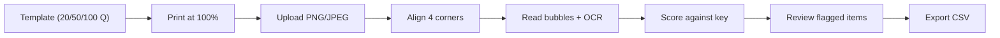

# AutoGradeQuiz

AutoGradeQuiz grades multiple-choice answer sheets from scanned or photographed pages. A teacher prints a sheet, students fill in the bubbles, and the app aligns the page, reads the marks, scores them against an answer key, lets the teacher fix doubtful answers, and exports the batch as CSV.

> **Status:** Backend and web client v1 are done. Tested on synthetic sheets only; not yet calibrated on real scans.

## How one sheet moves through the app



## Run it (Windows)

### Requirements

- Python 3.13+
- Node.js 20+ and npm
- [Tesseract OCR](https://github.com/tesseract-ocr/tesseract) (needed only to read Name, Date, and Section). Set `TESSERACT_CMD` to `tesseract.exe` if it is not on `PATH`.

### 1. Backend API

```powershell
cd backend
python -m venv .venv
.venv\Scripts\activate
pip install -e ".[dev]"
uvicorn app.main:app --reload
```

API docs: <http://127.0.0.1:8000/docs> (`GET /health` for health check). Uploads and SQLite data live under `backend/data/`.

### 2. Web client

```powershell
cd frontend
npm install
npm run dev
```

Open <http://localhost:3000>.

### 3. Try the demo

Generate sample filled-in sheets (requires the backend `.venv` activated and `PYTHONPATH=.` if not installed editable):

```powershell
cd backend
.venv\Scripts\activate
python scripts/generate_templates.py
python scripts/generate_synthetic_sheets.py --templates 20q_a4 --count 5
```

1. Print templates land in `backend/data/templates/` (print at 100% scale; never use "fit to page").
2. Synthetic sample sheets land in `backend/data/synthetic_sheets/20q_a4/`.
3. Open <http://localhost:3000>, create a test (`20q_a4`) and a batch, upload the generated PNGs, and click **Upload and grade**.

## Screens

- **Home (test, batch & upload):** Create a test with its template (`20q_a4`, `50q_a4`, `100q_a4`) and answer key, create a batch, then select multiple PNG/JPEG scans to upload and grade sequentially.

  

- **Results:** View every scan in the active batch with score, status, and review badge, regrade individual rows, and export the batch to CSV.

  

- **Review:** Work through scans flagged `needs_review` side by side with the aligned sheet image, fix flagged answers or identity fields, and save corrections.

  

## Settings & API overview

| Variable | Default | Purpose |
| --- | --- | --- |
| `AUTOGRADE_DATA_DIR` | `backend/data` | Uploaded and aligned scan images |
| `AUTOGRADE_DB_PATH` | `backend/data/autograde.db` | SQLite database file |
| `TESSERACT_CMD` | empty (uses `PATH`) | Full path to `tesseract.exe` |

| Method | Path | What it does |
| --- | --- | --- |
| `POST` | `/tests` | Create a test (`name`, `template_id`, `answer_key`) |
| `POST` | `/tests/{test_id}/batches` | Create a batch under a test |
| `POST` | `/batches/{batch_id}/scans` | Upload a PNG or JPEG scan (up to 10 MB) |
| `POST` | `/scans/{scan_job_id}/grade` | Grade a scan (`?force=true` to regrade) |
| `GET` | `/scans/{scan_job_id}/image` | Serve the scan image for review |
| `GET` | `/batches/{batch_id}/results` | List batch results and job statuses |
| `GET` | `/batches/{batch_id}/export.csv` | Download batch results as CSV |
| `GET` | `/review-queue` | List scans needing review |
| `PATCH` | `/scans/{scan_job_id}/corrections` | Save answer corrections (`{"corrections": {"1": "B"}}`) |
| `PATCH` | `/scans/{scan_job_id}/identity` | Update Name, Date, or Section |

## How it was tested

Run from `backend/` with `.venv` activated (and `PYTHONPATH=.` for `scripts/read_check.py`):

- `pytest`: **121 passed** (in 133.18s)
- `ruff check .`: **All checks passed**
- `python scripts/read_check.py --seeds 50`: **150 synthetic sheets** (50 per template: `20q_a4`, `50q_a4`, `100q_a4`), **8,500 questions**, **0 failed sheets**, **0 mismatches** (max observed rotation angle 4.991 deg).

Synthetic testing verifies the pipeline against simulated marks and scan artifacts, but it does not prove accuracy on real printed/photographed paper, varied lighting, camera lens distortion, or handwritten names and dates.

## Known limits

- **Flagged-only corrections:** Only questions flagged `ambiguous`, `multiple`, or all-blank can be corrected in review.
- **Handwriting OCR:** Tesseract OCR is weak on handwriting; use the review screen to fix Name, Date, or Section.
- **Thresholds & capture conditions:** Bubble fill thresholds are calibrated on synthetic marks only; scans with extreme perspective or very uneven lighting can be rejected (`422`).
- **Synchronous grading:** Grading runs inside the HTTP request with no background worker or queue.
- **Upload checks:** Uploads are validated by content type (`image/png`, `image/jpeg`) and size (10 MB max) only.
- **Deployment & desktop:** No Docker setup yet; the web client runs in a browser only (Tauri desktop packaging is deferred).

## Project layout

```text
backend/
  app/
    answer_sheet_templates/   template definitions and geometry
    sheet_rendering/          draws printable sheets
    scan_alignment/           finds corner markers and warps scans
    bubble_grading/           bubble classifier and scoring
    grading_pipeline/         grades one scan job end to end
    db/                       SQLite schema and repositories
    synthetic_sheets/         synthetic filled-in sheets for tests
    main.py, routers.py       FastAPI app and routes
  data/templates/             printable sheets and template JSON
  scripts/                    template, synthetic sheet, and read-check scripts
frontend/
  src/                        Next.js web client
docs/
  screenshots/                placeholder folder for UI screenshots
```
