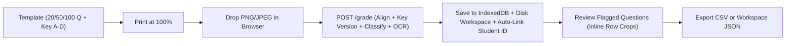

# AutoGradeQuiz

AutoGradeQuiz grades multiple-choice answer sheets from scanned or photographed A4 pages. The Next.js frontend stores quizzes, classes, student rosters, and graded papers in browser IndexedDB with automatic disk sync to the backend workspace (`workspace/workspace.json` plus raw/aligned/graded scan images) and portable `.json`/`.csv` exports. The FastAPI backend is a stateless computer-vision, bubble-classification, and OCR grading service.

> **Status:** Verified on synthetic sheets (`102` backend tests, `40` frontend unit tests, `150`-sheet evaluation harness with `0.00%` unflagged errors). Not yet calibrated on real photographed paper under uneven lighting.

- [Tech Stack & Dependencies](#tech-stack--dependencies)
- [How the Bubble Scanning Pipeline Works](#how-the-bubble-scanning-pipeline-works)
- [Part 1: Backend](#part-1-backend)
- [Part 2: Frontend](#part-2-frontend)
- [Project Layout](#project-layout)



---

## Tech Stack & Dependencies

### Backend (`backend/pyproject.toml`, Python 3.13+)

| Library | Version | Role |
| --- | --- | --- |
| `fastapi` + `uvicorn[standard]` | `>=0.115.0` / `>=0.32.0` | HTTP API (`/health`, `/templates`, `/grade`, `/tests/scan-key`, `/workspace/*`, `/test-ui`) |
| `opencv-python-headless` | `>=4.10.0` | Otsu thresholding, contour fiducial detection, 4-point perspective warp, graded overlay rendering, and connected-component bubble analysis |
| `numpy` | `>=2.1.0` | Vectorized circular disc masks, per-sheet white/black ink calibration, and percentile measurements |
| `pytesseract` | `>=0.3.13` | Tesseract OCR wrapper (`--psm 7`) for reading `Name`, `Date`, `Section`, and `Student ID` header boxes |
| `pillow` | `>=11.0.0` | Printable 300 DPI PDF template generation (`Key Version: A B C D` bubble strip included) |
| `pydantic` + `pydantic-settings` | `>=2.9.0` / `>=2.6.0` | Request/response validation and environment configuration (`TESSERACT_CMD`, `AUTOGRADE_DATA_DIR`, `AUTOGRADE_WORKSPACE_DIR`) |
| `pytest` + `ruff` *(dev)* | `>=8.0` / `>=0.8.0` | Unit/integration test runner and linter |

### Frontend (`frontend/package.json`, Node.js 22.6+)

| Library | Version | Role |
| --- | --- | --- |
| `next` + `react` + `react-dom` | `16.3.0` / `19.2.8` | App Router UI (`/`, `/classes`, `/classes/[id]`, `/students`, `/students/[id]`, `/quizzes/[id]`, `/review`, `/sections` alias) |
| `idb` | `^8.0.4` | Typed IndexedDB wrapper for local-first storage (`quizzes`, `batches`, `papers`, `paperImages`, `sections`, `students`) |
| `tailwindcss` | `^4` | Styling and design tokens |
| `fake-indexeddb` *(dev)* | `^6.2.8` | In-memory IndexedDB for Node.js unit tests (`node --test`) |

---

## How the Bubble Scanning Pipeline Works

Every `POST /grade` request runs a 4-stage pipeline in `backend/app/`:

1. **Fiducial Detection & Perspective Alignment (`scan_alignment/align_scan.py`)**
   - Each A4 sheet (`210 × 297 mm` at `300 DPI` = `2480 × 3507 px`) has four `8 × 8 mm` solid black corner fiducials plus asymmetric mid-edge markers.
   - The aligner tests all 4 cardinal orientations (`0°`, `90°`, `180°`, `270°`), locates the corner squares inside corner search windows via Otsu thresholding and min-area rectangle filtering (falling back to a mid-edge marker if one corner is clipped), warps the sheet back to canonical A4 coordinates with `cv2.getPerspectiveTransform`, and picks the orientation where the expected mid-marker positions are darkest.
2. **Per-Sheet Ink Calibration (`bubble_grading/classifier.py`)**
   - Each aligned sheet calibrates its own `white` level (median pixel intensity of the blank lower paper band) and `black` level (median intensity of the inner 50% of the four corner fiducials).
   - Every pixel is converted into a normalized ink fraction in `[0.0, 1.0]`: `clip((white - px) / (white - black), 0, 1)`.
3. **Key Version Strip, Inner-Disc Classification & Partial-Credit Scoring (`bubble_grading/`)**
   - Reads the printed `Key Version: A B C D` strip below the header (`classify_key_version`), selects the matching key version when configured, and flags ambiguous/multiple/unconfigured marks for teacher review.
   - Each bubble is sampled inside its inner circular disc (`radius - outline_thickness - 1`) using **mean ink** (`fill_ratio`), **90th-percentile peak ink** (`trace_ratio`), and **largest connected dark component area** (`blob_ratio`).
   - Classifies each row into `BLANK`, `FILLED`, `MULTIPLE`, or `AMBIGUOUS`, and scores primary/multi-mark keys, per-question point weights, alternate partial-credit answers, and attempted-but-incorrect rules (`scoring.py`).
4. **Header Ink Check & Tesseract OCR (`grading_pipeline/grade_scan_job.py`)**
   - Crops the `Name`, `Date`, `Section`, and `Student ID` boxes (`builder.py`).
   - Checks interior dark-pixel share so blank boxes skip Tesseract; non-empty boxes run `pytesseract.image_to_string(..., config="--psm 7")`.

---

## Part 1: Backend

### Requirements
- Python 3.13+
- [Tesseract OCR](https://github.com/tesseract-ocr/tesseract) to read `Name`, `Date`, `Section`, and `Student ID` boxes. Set `TESSERACT_CMD` to the `tesseract.exe` path if it is not on `PATH`.

### Setup and run (Windows)

```powershell
cd backend
python -m venv .venv
.venv\Scripts\activate
pip install -e ".[dev]"
uvicorn app.main:app --reload --host 127.0.0.1 --port 8000
```

- OpenAPI docs: <http://127.0.0.1:8000/docs>
- Developer sandbox (with synthetic sheet generator & PNG download): <http://127.0.0.1:8000/test-ui>

### Generate printable templates and synthetic sheets

```powershell
cd backend
.venv\Scripts\activate
$env:PYTHONPATH = "."
python scripts/generate_templates.py
python scripts/generate_synthetic_sheets.py --templates 20q_a4 --count 5
```

Printable templates are written to `backend/data/templates/` and copied on demand into `workspace/templates/`. Print them at 100% scale ("Actual size"). Synthetic test sheets are written to `backend/data/synthetic_sheets/20q_a4/`.

### Settings and API routes

| Variable | Default | Purpose |
| --- | --- | --- |
| `TESSERACT_CMD` | empty (uses `PATH`) | Full path to the `tesseract` binary |
| `AUTOGRADE_DATA_DIR` | `backend/data` | Directory for bundled template assets and CLI outputs |
| `AUTOGRADE_WORKSPACE_DIR` | `workspace` | Local disk workspace directory for `workspace.json`, `scans/`, and `templates/` |

| Method | Path | Purpose |
| --- | --- | --- |
| `GET` | `/health` | Return `{"status": "ok"}` |
| `GET` | `/templates` | List template IDs (`20q_a4`, `50q_a4`, `100q_a4`) and question counts |
| `POST` | `/grade` | Align, detect key version, classify, score (multi-key + partial rules), and OCR one sheet image |
| `POST` | `/tests/scan-key` | Read a filled master sheet image and return its answer key |
| `GET` | `/workspace/status` | Return disk workspace health, `workspace.json` presence, and scan artifact count |
| `GET` / `PUT` | `/workspace/data` | Read or atomically save `workspace.json` and prune orphaned scan artifacts |
| `GET` | `/workspace/templates/{template_id}` | Download printable A4 template PDF |

### Verification (`backend/`)

```powershell
cd backend
.\.venv\Scripts\ruff.exe check .
.\.venv\Scripts\python.exe -m pytest -q
.\.venv\Scripts\python.exe tools/eval_accuracy.py --seeds 50
```

---

## Part 2: Frontend

### Requirements
- Node.js 22.6+ and npm
- Running backend grader at `http://127.0.0.1:8000` (or set `NEXT_PUBLIC_API_URL`)

### Setup and run (Windows)

```powershell
cd frontend
npm install
npm run dev
```

Open <http://localhost:3000>.

### Scripts (`frontend/package.json`)

| Script | Command | Purpose |
| --- | --- | --- |
| `dev` | `next dev` | Start the local Next.js development server |
| `build` | `next build` | Build for production and run TypeScript checks |
| `start` | `next start` | Serve the production build |
| `lint` | `eslint` | Run ESLint |
| `test` | `node --test src/lib/*.test.ts` | Run unit tests for answer keys, scoring, geometry, analytics, and IndexedDB workspace |

### Screens
- **Quizzes (`/`)**: Folder/class/tag filters, sort and search, workspace stats, 2-step **New Quiz** wizard (Name, Template, Date, Folder, Classes, Tags → full-width Answer Key editor), **Save workspace (`.json`)**, and **Open workspace (`.json`)**.
- **Quiz menu (`/quizzes/[id]`)**:
  - **Papers tab**: Drag-and-drop PNG/JPEG sheets to grade via `POST /grade`, auto-link papers by scanned `Student ID`, toggle graded overlays, or export UTF-8 BOM CSVs.
  - **Statistics tab**: Score summary (`Min`, `Max`, `Average`, `Median`, `Std Dev`), score distribution histogram, and Key Version breakdown.
  - **Item analysis tab**: Per-question difficulty, choice distribution, and discrimination index with optional Key Version filtering.
  - **Tag report tab**: Per-question/quiz tag earned points and proficiency summary.
  - **Answer key tab**: Multi-version key tabs (`A: Primary`, `B`–`D`), inline partial-credit & tag **Answer Detail** rules, bulk point editor, and **Scan key from sheet**.
  - **Batches tab**: Organize paper stacks by class.
- **Classes (`/classes`, `/classes/[id]`)**: Manage classes, enroll/remove students (with student picker), and review quizzes assigned to each class.
- **Students (`/students`, `/students/[id]`)**: Sortable, filterable student directory with auto-generated 5-digit codes, per-student quiz history with score progression, and retroactive auto-linking of papers matching `Student ID`.
- **Review Papers (`/review`)**: Student identity & Key Version (`A–D`) override bar, full aligned/graded scan preview with millimeter locator box, and zoomed row crops for flagged questions (`A`–`E`, `Backspace`, `↑`/`↓`, `←`/`→`, `Enter`).

---

## Project Layout

```text
backend/
  app/
    answer_sheet_templates/   A4 template specs (20q, 50q, 100q), header boxes, Key Version A-D geometry
    sheet_rendering/          printable PDF/PNG sheet renderer and synthetic text drawer
    scan_alignment/           corner/mid fiducial detection and perspective warp
    bubble_grading/           normalized-ink classifier, overlay renderer, and partial-credit scorer
    grading_pipeline/         stateless multi-key grade pipeline and Tesseract OCR
    synthetic_sheets/         reproducible synthetic sheet generator for tests
    main.py, routers.py       FastAPI app and stateless grading endpoints
    workspace_router.py       /workspace/* JSON persistence and template download routes
    workspace_storage.py      atomic workspace.json I/O, scan artifacts, and orphan pruning
    test_ui.html              developer testing sandbox (/test-ui)
  scripts/                    printable template and synthetic sheet CLI scripts
  tools/                      accuracy evaluation harness (eval_accuracy.py)
frontend/
  src/
    app/                      Next.js routes (/, /classes, /classes/[id], /students, /students/[id], /quizzes/[id], /review)
    components/               AppShell, AnswerKeyGrid, quiz/, roster/, review/, and ui/ primitives
    lib/                      answerKey, scoring, sheetGeometry, itemAnalysis, statistics, tagReport, api
    lib/workspace/            IndexedDB store modules (quizzes, papers, roster, reports, keyVersion, backup, diskSync, serialize)
workspace/                    local workspace folder (workspace.json, scans/, templates/)
```
